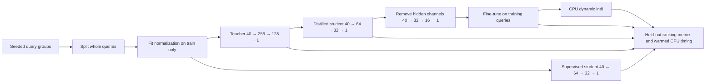

# Rank Compression Lab

A small, reproducible recommendation reranker experiment: compare a teacher, a
supervised student, a distilled student, physical channel pruning, and CPU int8
deployment on the same held-out query groups.

The point is to make the quality/storage/latency trade-off inspectable. The data is
synthetic, and the models are MLP rerankers. This is a ranking-model optimization
prototype, not an LLM compression result or evidence of production recommendation
quality.

## Quickstart

Python 3.11–3.13. No GPU, external dataset, model download, API key, or paid service
is required. PyTorch is pinned to 2.8.0 and NumPy to 2.4.6.

```bash
python3 -m venv .venv
source .venv/bin/activate
python -m pip install -e '.[dev]'
python -m pytest -q
rank-compress train
```

The last command retrains all five variants, writes ignored checkpoints under
`artifacts/checkpoints/`, and writes the raw measurement report to
`reports/local_cpu.json`. To preserve the committed reference report:

```bash
rank-compress train --report artifacts/my_cpu_run.json
```

A short end-to-end check, also used in CI:

```bash
rank-compress train --queries 96 --candidates 16 --epochs 2 \
  --finetune-epochs 1 --warmup 2 --repetitions 5 \
  --report artifacts/smoke.json
```

## Reference measurement

Measured on an arm64 macOS CPU with PyTorch 2.8.0 and QNNPACK, using one PyTorch
intra-op thread. These are actual measurements from the committed
[raw report](reports/local_cpu.json), not estimates. The run uses 960 query groups
with 32 candidates each, a 672/144/144 train/validation/test split, and seed 2026.

| Variant | NDCG@10 | Recall@10 | Checkpoint KiB | p50 ms | p95 ms |
| --- | ---: | ---: | ---: | ---: | ---: |
| teacher_fp32 | 0.9612 | 0.9488 | 173.89 | 0.0481 | 0.0507 |
| student_supervised_fp32 | 0.9674 | 0.9470 | 22.61 | 0.0193 | 0.0203 |
| student_distilled_fp32 | 0.9722 | 0.9575 | 22.59 | 0.0190 | 0.0202 |
| student_pruned_fp32 | 0.9761 | 0.9618 | 11.24 | 0.0168 | 0.0173 |
| student_pruned_int8 | 0.9750 | 0.9583 | 7.85 | 0.0601 | 0.0670 |

The final int8 checkpoint is about **22.2× smaller** than the FP32 teacher. It is
**slower than the pruned FP32 model on this CPU**: quantization overhead dominates
this small network. The smaller supervised student already outperforms the teacher
on this synthetic task, so distillation is compared against that supervised
student as well. The pruned model receives 15 extra fine-tuning epochs; its higher
score is not evidence that pruning alone improves relevance.

Latency is one forward pass on 8 queries × 32 candidate rows, with pre-normalized
resident tensors, 50 warmups and 200 timed repetitions. The table excludes model
loading, normalization, serialization, network calls, and request scheduling.
Quality evaluation also uses 8-query batches: dynamic activation quantization can
make int8 results depend slightly on batch composition. Report fields retain
every timing sample, per-query quality scores, training
history, split query IDs, backend, thread counts, package versions, and PyTorch
build metadata. Timings are from one host run in a fixed variant order and do not
establish service-level latency or a guaranteed speedup. Checkpoint size includes
state, normalization statistics, and serialization overhead; it is not process
memory usage.

## Experiment design



**Data and splitting.** Each query contains a synthetic user vector, query vector,
and candidate item vectors, all with eight dimensions. Elementwise user–item and
query–item interactions give 40 input features. A fixed nonlinear scoring function
plus Gaussian noise assigns four relevance grades by within-query rank. For 32
candidates, the best four receive grade 3, the next four grade 2, the next eight
grade 1, and the remaining sixteen grade 0. All candidates of a query stay in one
split; query IDs are disjoint. Normalization statistics are fitted on training
features only. Validation NDCG selects each training checkpoint. Test labels are
used for the final evaluations, after all training is complete.

**Supervised baseline.** Train with a listwise cross entropy whose target
distribution is `softmax(1.5 × relevance_grade)` within each query. Both students
start from identical weights and use the same minibatch order and training budget.

**Knowledge distillation.** The teacher is frozen. For training queries, combine
the supervised loss with `T² × KL(softmax(teacher/T) || softmax(student/T))`, with
`T=2` and a distillation weight of `0.6`. The KL is reduced per query, rather than
across individual candidate rows. Teacher outputs are detached, and teacher
inference is precomputed only for training features.

**Physical structured pruning.** Rank hidden channels by the product of the L2
norms of their incoming and outgoing weights, retain half of each hidden layer,
then copy the retained rows and columns into newly allocated, smaller `Linear`
layers. This changes the dense matrix shapes; it does not retain zero masks in
the original matrices. Fine-tune the compact student with the same combined loss.
An equivalence test checks the compact network against the original network with
removed hidden activations explicitly zeroed.

**CPU dynamic int8.** Quantize the fine-tuned pruned model's `Linear` layers. The
code chooses an engine supported by the local PyTorch build, preferring QNNPACK
on ARM and x86/FBGEMM on x86. This PyTorch 2.8 path stores quantized weights and
uses dynamic activation quantization inside the operators; it is not a fully
integer input/output model. This legacy eager API emits a deprecation warning;
the dependency is pinned, and a future PyTorch upgrade should migrate the export
path to torchao. QNNPACK also emits its `reduce_range` warning in this environment;
the report records the engine and the quality metrics reflect the executed path.

**Quality metrics.** NDCG@10 uses gains `2^grade − 1` and log2 position discounts.
Recall@10 counts candidates with grade ≥2 as relevant, so there are eight relevant
candidates per query in the reference run. Both metrics are averaged per query.
Zero-relevance queries return zero, and tied scores retain original candidate
order. This dataset has no exposure bias, temporal drift, repeated user history,
retrieval stage, real catalog, or click feedback; high scores should be interpreted
within that controlled task only.

## Deployment and input contract

Checkpoints contain the architecture, state, training normalization statistics,
and quantized engine. The load path rebuilds the same module structure, uses
`weights_only=True`, restores its state, and runs in inference mode on CPU.

```bash
rank-compress infer \
  --checkpoint artifacts/checkpoints/student_pruned_int8.pt --demo

rank-compress infer \
  --checkpoint artifacts/checkpoints/student_pruned_fp32.pt \
  --input request.json --output artifacts/prediction.json
```

`request.json` contains `{"features": [...]}` with an array of shape
`[query_count, candidate_count, 40]`. Features are **raw**, unnormalized values in
this order: `user[8], query[8], item[8], user*item[8], query*item[8]`. User and query
context repeat across the candidates of a group. The CLI applies the saved
normalizer and returns scores plus candidate indices in descending score order.
No HTTP serving layer is included. Quantized checkpoints require their saved
engine to be supported on the target host; re-export for a different backend.

Useful controls include `--threads`, `--benchmark-batch-queries`,
`--repetitions`, `--temperature`, `--kd-alpha`, and `--keep-fraction`. Run
`rank-compress train --help` for the full configuration. Checkpoints are ignored
to keep the repository small; regenerate them with the documented command.

## Tests and references

Tests cover hand-calculated NDCG/recall, macro aggregation, deterministic query
splits, normalization, compact-pruning equivalence, teacher gradient isolation,
and FP32/int8 checkpoint reloads and output shapes. CI additionally runs the
five-variant pipeline at a small scale; no test asserts that int8 is faster.

Primary references:

- [PyTorch 2.8 dynamic quantization](https://docs.pytorch.org/docs/2.8/generated/torch.ao.quantization.quantize_dynamic.html)
- [PyTorch 2.8 KL divergence and `batchmean` reduction](https://docs.pytorch.org/docs/2.8/generated/torch.nn.KLDivLoss.html)
- [PyTorch structured pruning API](https://docs.pytorch.org/docs/2.8/generated/torch.nn.utils.prune.ln_structured.html) — a related masking approach; this repository copies channels into compact layers instead.

MIT licensed. Developed by Qingquan Wang, 2026.
